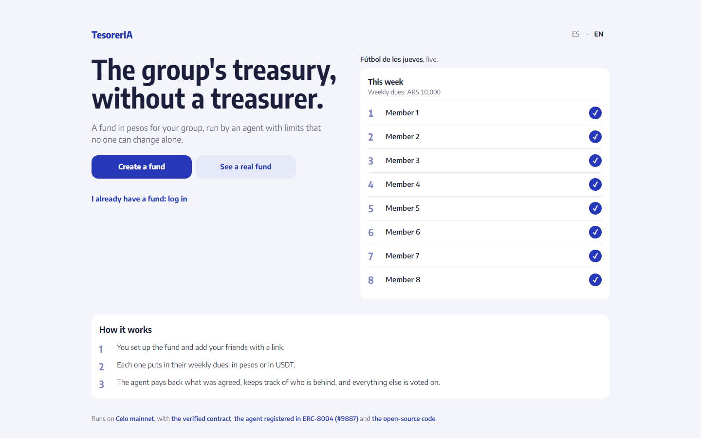
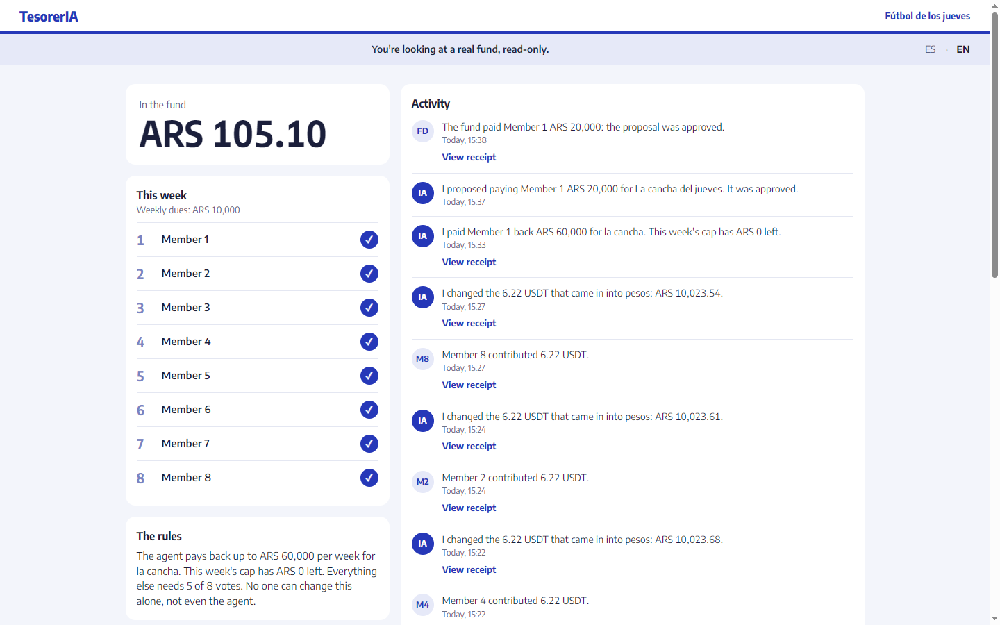
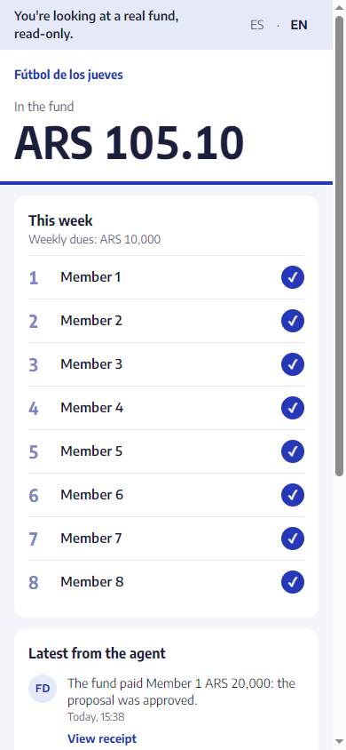

# TesorerIA

**The group's treasury, without a treasurer.**

TesorerIA is an AI treasurer for a group's shared fund in Argentine pesos (wARS) on Celo. Members contribute to a smart contract. The agent converts USDT to wARS, reimburses the expense the group agreed on (up to a weekly cap), keeps track of who is behind, writes the group a summary of each week, and puts everything else to a vote. The contract enforces the limits: the agent can only pay members, never above the cap, and can't change the rules.

**Where the AI is, and where it isn't.** The part that signs and moves money is deterministic code with no language model ([the agent](#the-agent)): the same inputs always lead to the same transaction, and every rule it follows has a test. The AI is how the group talks to it: a chat with Claude that reads what the member sees on their screen, answers in their language, and can only offer a card to enter an expense, which the member confirms. The chat never signs anything.

Built for the [Agents on Open Rails](https://www.loops.house/agents-on-open-rails) hackathon (Celo × Ripio), track Stable Agents: LatAm.

- **The app:** [tesoreria.finance](https://tesoreria.finance), in Rioplatense Spanish or English. The browser's language picks one, and an ES · EN switch changes it.
- **A real fund, read-only:** [Fútbol de los jueves](https://tesoreria.finance/f/0x9A74F670F3c59Ae4B8450fdD477b0461b89D2dfD/publico), eight friends who split a football pitch every Thursday. Their names are hidden.
- **The old address:** `tesoreriaia.vercel.app`, the app's first address, redirects to `tesoreria.finance`.

  
  

  

## On mainnet today

As of November 8, 2026: two funds of the same eight friends. The football fund has closed four weeks, and the Friday barbecue fund two. Together they took in 55 contributions for ARS 490,139 and paid out ARS 490,033.

- **The football fund:** [`0x9A74F670F3c59Ae4B8450fdD477b0461b89D2dfD`](https://celo.blockscout.com/address/0x9A74F670F3c59Ae4B8450fdD477b0461b89D2dfD), created by the `FundFactory`. Each member pays ARS 10,000 a week. The agreed expense is the pitch, paid back up to ARS 60,000 a week, and anything else needs 5 of the 8 votes. Its source is verified on [Sourcify](https://repo.sourcify.dev/42220/0x9A74F670F3c59Ae4B8450fdD477b0461b89D2dfD) (exact match), so [Blockscout](https://celo.blockscout.com/address/0x9A74F670F3c59Ae4B8450fdD477b0461b89D2dfD?tab=contract) decodes every call, for example `reimburseAgreedExpense(address member, uint256 amount, bytes32 ref)`.
- **The Friday barbecue fund:** [`0x4f450A9F80B44100aC335D6185B7486870Abd42c`](https://celo.blockscout.com/address/0x4f450A9F80B44100aC335D6185B7486870Abd42c), "Juntada de los viernes", created from the app on October 20. Four of the eight started it, with ARS 10,000 a week each, "carne + bebida" (meat and drinks) as the agreed expense, paid back up to ARS 10,000 a week, and 3 of 4 votes. Its first vote added a fifth member: [the proposal](https://celo.blockscout.com/tx/0xa7269e1886139f9fc8592b1ed69cbde3bc5c4a14a74def5bff1712823cee47ba) and [the third vote](https://celo.blockscout.com/tx/0x7498050a838de045a650f94e3afb8649c981f27223b9711188a1bc7db41f4490), which carried it out. Its source is verified on [Sourcify](https://repo.sourcify.dev/42220/0x4f450A9F80B44100aC335D6185B7486870Abd42c) too (exact match).
- **Everyone was paid up at every weekly close.** 32 of the 55 contributions came in USDT, which many Argentines save in, and the agent changed each one to pesos as it came in: for example, [a contribution](https://celo.blockscout.com/tx/0x79f7f76fbb0db90c4fcf5465f16a240ded8e479aed41b2b2b4385888dfcbf678) and [its conversion](https://celo.blockscout.com/tx/0x2bffd790f73cb61a4e69769af38bdaaf56d088cd2acdf66eb879f8bace2e2167). The funds hold, pay and settle in wARS.
- **Out to a bank through Ripio.** On November 6, the agent [paid back ARS 10,000](https://celo.blockscout.com/tx/0xdff54bfae4a65840da143ff94953ce1968ce41792a019d486a8be2819bf4ae5e) of the barbecue fund's "carne + bebida" to the member who bought it. From "Pasar a pesos", that member tapped "Vender con Ripio" and [sent the ARS 10,000](https://celo.blockscout.com/tx/0x8bfd6baf96004a6f9e41688e95b393e9ca6b10fa8e21d80561ead55d02d9b47d) to the Celo address Ripio's off-ramp gave them. Ripio sold the wARS 1:1 and paid the pesos into their bank. From the expense to the bank, the money never left pesos.
- **The pitch costs ARS 80,000, more than the agent can pay back in a week.** In the first week, the member who paid it entered it as two expenses. The agent [paid back the ARS 60,000](https://celo.blockscout.com/tx/0x36d86a543965b5449416104e5fc7f1cf9398447e3ca67edf7e854e1878658f82) entered as the agreed expense on its own, the whole weekly cap, and turned the other ARS 20,000 into [a proposal](https://celo.blockscout.com/tx/0x64e6f50da0de85cfc19c50776337ca21cb2099297ac5ecf37c61a36a046a148e). Five members voted for it, from [the first vote](https://celo.blockscout.com/tx/0xfec549cf6cdf0d8bfac0d9568df86bbf146a8f441fe1fa8cc170169e863332a4) to [the fifth](https://celo.blockscout.com/tx/0x15f59b43218aec7574e0eebf34cf2c74ff666707d15013f7a077ad37ea965b1e), which carried it out and paid the member in the same operation. Since then it's entered as one expense of ARS 80,000, which doesn't fit in the cap, so the agent proposes it whole and the group votes: in the third week, [the agent's proposal](https://celo.blockscout.com/tx/0x8dbe00d1fb46a3f46a5d9abc58181459a5d02d48664f8645ad444335131468c3) and [the fifth vote](https://celo.blockscout.com/tx/0x95f2d396ef414363c0c50d87b51c6cdb29cc30d62657b178de183c485b4bdc45).
- **A summary of each week, checked against the chain.** When a week closes, the agent writes the group who paid, what came in and what was paid out. The six so far match the chain to the cent: for example, [the football fund's fourth week](https://tesoreria.finance/f/0x9A74F670F3c59Ae4B8450fdD477b0461b89D2dfD/publico?p=resumen&semana=4). One, the barbecue fund's second week, first came out short because the block explorer the app read from had fallen behind; nobody sent it, and since then the app keeps each fund's history in its own database and checks it against the contract.
- **Every one of these transactions carries the attribution tag `celo_fbe4d00a2cb4`:** the agent's at the end of their calldata, and the members' inside each UserOperation.

## How TesorerIA meets the Stable Agents: LatAm criteria

| Criterion | How TesorerIA meets it | Where to check |
|---|---|---|
| 1. Live on Celo mainnet with a real wFIAT and real transactions | Two funds of the same eight friends, live since October: 55 contributions for ARS 490,139 in and ARS 490,033 paid out, as of November 8. Every weekly summary matches the chain to the cent. On November 6, a member sold ARS 10,000 through Ripio's off-ramp and was paid in their bank. | [On mainnet today](#on-mainnet-today), and the funds on Blockscout from [On Celo mainnet](#on-celo-mainnet) |
| 2. wFIAT at the core, and the Celo stack | The funds hold, pay and settle in wARS: USDT contributions are changed to wARS as they come in, and Ripio's ramps sit inside the app, "Load pesos with Ripio" to come in and "Sell with Ripio" to go out to a bank. The agent has an ERC-8004 identity (agent 9887). Every transaction carries the attribution tag `celo_fbe4d00a2cb4`, the members' inside each UserOperation. Members never need CELO: their operations are sponsored. | [The web](#the-web), [On Celo mainnet](#on-celo-mainnet) |
| 3. The agent acts on its own, with clear logic and limits | It converts USDT to wARS after checking the price against Chainlink, pays back the agreed expense up to the weekly cap, turns anything else into a proposal, tracks who is behind and writes each week's summary. The contract only lets it pay members, never above the cap, and it can't change the rules. Its own limits sit on top: per reimbursement, per day, per conversion, and a number of transactions a day. The part that signs is deterministic code with tests; the AI only talks. | [The agent](#the-agent) |
| 4. Someone new to crypto completes the flow, in their own currency | A passkey (fingerprint, face or PIN) controls their own Safe account: no seed phrase, no extension, no gas. Every amount is in pesos, in Rioplatense Spanish or English. Pesos come in from Ripio, and what a member is paid back goes out to their bank with "Sell with Ripio". | [The web](#the-web), [the first sale to a bank](https://celo.blockscout.com/tx/0x8bfd6baf96004a6f9e41688e95b393e9ca6b10fa8e21d80561ead55d02d9b47d) |
| 5. Impact in LatAm | For groups that share a recurring cost in pesos: a football pitch, a barbecue, a flat, a trip. A real group of eight friends uses it every week, each member signing their own operations, and everyone was paid up at every weekly close. | [On mainnet today](#on-mainnet-today), [What's next](#whats-next) |

Dashboards that read only the agent's wallet undercount TesorerIA: the money moves between the members and the fund's contract, never through the agent, and the members sign their own tagged UserOperations.

## What's next

**The goal: 5 groups by December 31, 2026, and 20 by March 31, 2027,** measured in groups, members, wARS moved, and the share of contributions paid directly in wARS (23 of 55 so far).

**What a group costs, and who pays.** Over the football fund's first three weeks, a group of eight cost about US$0.10 a week on chain (ARS 165), 0.2% of the ARS 80,000 it puts in, or about US$5 a year. The members' contributions and votes are sponsored, about 14 operations a week at 0.069 CELO each; the agent's own transactions, about 7 a week, it pays from its wallet in USDT. Hosting and the chat's model calls are not included. The team covers the first 5 groups, about US$26 a year. From the next `FundFactory` on, each new fund pays its own way: the contract keeps 0.25% of each contribution for gas, ARS 25 of an ARS 10,000 due, which covers the ARS 165 a week a group of eight costs.

- **The sponsor's limits.** The paymaster policy allows 600 operations in total and 30 per account, and neither resets. The members of the two funds have used 93, and the busiest account 18 in the funds alone. Both move to limits that reset every month before the December goal.
- **More groups in Argentina.** The same fund works for any group that shares a recurring cost: a flat, a trip, a padel court.
- **Reminders by email.** The weekly summary already tells the group who owes what, for a member to share; an email would reach whoever doesn't open the app. It waits until groups ask for it, since it takes a domain of its own.
- **Other wFIAT currencies.** The factory is fixed to wARS, USDT and their Uniswap pool, so wBRL or wMXN take a factory of their own, once a pool holds enough liquidity.
- **MiniPay.** Opening the app inside MiniPay takes a single contract for every fund, since MiniPay only allows contracts it approved. That's the path to reach people where they already hold stablecoins.
- **Giving back a contribution.** The contract has no way to return one: it goes out as a payment, like the pitch, and still counts as contributed. So when the football fund gave a member back ARS 10,000 of a contribution, the app counts them a week further ahead on their dues than they are, and that money would still weigh in their share if they left or the fund closed. The app will mark that kind of payment and take it off what the member put in, and the next `FundFactory` will add an action that does the same on chain.

## How to run

Once the dependencies are installed, the builds and tests below need no network, keys or accounts. You need Node.js 24, pnpm 12 (`corepack enable` installs the version `package.json` pins) and Foundry 1.8.5 (`foundryup --install 1.8.5`).

    git clone --recurse-submodules https://github.com/ruizemanuel/TesorerIA && cd TesorerIA
    pnpm install --frozen-lockfile
    cd contracts && forge build && FOUNDRY_PROFILE=ci forge test && cd ..   # the contracts: unit, fuzz and invariant tests, with mocks
    pnpm test                                                              # the wallet, the agent and the web, on an in-memory Postgres
    pnpm typecheck

- **`forge build` downloads solc 0.8.37 the first time,** unless it's already installed.
- **Without `--recurse-submodules`,** `forge build` fetches forge-std and OpenZeppelin itself, at the pinned commits. From a source archive, with no git, their folders come empty: from `contracts/`, remove them and install the same tags with `rmdir lib/forge-std lib/openzeppelin-contracts && forge install --no-git foundry-rs/forge-std@v1.17.0 OpenZeppelin/openzeppelin-contracts@v5.7.0`. The Uniswap v3 files are in the repo ([why](contracts/lib/v3-core/README.md)).
- **Build the contracts before `pnpm test`:** one of the agent's tests compares its ABIs with the compiled contracts, and skips itself without them.
- **On a machine with little memory, run `pnpm test --maxWorkers=2`:** each of the web's test workers can take up to about 1 GB, for its in-memory databases.

These need the network, since they run against a fork of Celo mainnet (Foundry's `anvil` and `forno.celo.org`): the fork tests (`pnpm test:fork`, and `forge test --match-path "test/fork/*"` in `contracts/`), the end-to-end test (`pnpm --filter @tesoreria/web test:e2e`, after `pnpm --filter @tesoreria/web exec playwright install chromium`), and the app on a local fork (`pnpm --filter @tesoreria/web e2e:serve`, see [the web](#the-web)).

## The agent

`packages/agent` is the agent's deterministic core: TypeScript and viem, no language model. It is the only part that signs, and every transaction it sends pays its gas in USDT (CIP-64) and carries the ERC-8021 attribution suffix.

- **Convert:** when a fund holds 5 USDT or more, the agent swaps them for wARS in the Uniswap v3 pool, as long as Chainlink's USD / ARS (Base) is less than 26 hours old, the pool holds at least 10 times the wARS the conversion takes, and the pool's price is within 2% of Chainlink's USD / ARS × USDT / USD. Its `minWarsOut` sits 0.5% under Uniswap's quote, not at the contract's 2% floor.
- **Pay back the agreed expense:** when a member enters it and it fits in what's left of the week's cap, never twice for the same expense (the contract doesn't check that). Anything else becomes a payment proposal for the members to vote on. A member could enter an expense they never paid, but the contract caps what it costs the group at the weekly cap, it only ever pays members, and every reimbursement shows on the fund's timeline for everyone to see.
- **Dues:** it works out what each member owes at the group's weekly fee, and what each one would get if the fund closed today.
- **Sum up the week:** when a week of a fund closes, the next heartbeat keeps a snapshot of it, read at the week's last block (only the week that just closed: a week missed while the heartbeat was down is skipped, never written late): the balance, what each member still owes, what was contributed, every reimbursement and approved payment, and who joined. The web turns it into a message in the reader's language, for a member to send to the group's chat. Fixed sentences, no language model: the numbers are the screen's.

Its own limits, on top of the contract's: it only pays addresses the contract lists as members, never one taken from text a person or a model wrote; at most 100,000 wARS per reimbursement and 150,000 wARS a day per fund, 500 USDT per conversion and 1,000 USDT a day, and 20 transactions a day per fund. A reimbursement over a limit becomes a proposal. Every decision, including what it didn't do and why, comes back as an entry for the fund's timeline.

In production the agent runs inside the web (below), and only on the funds the web created: anyone can create a fund that names our agent, and those are never read or acted on. A run holds a database lock that outlives it (310 s, above the routes' 300 s limit), so two runs never pay the same expense. Each expense a member enters goes through these states:

- `new`: entered, not handled yet;
- `sending`: the agent sent its transaction and is waiting for the receipt. It is never sent again on a guess: if the run died before keeping the hash, the expense goes back to the queue only once the lock has expired and none of the agent's transactions is waiting to be mined;
- `reimbursed` or `proposed`: done, as a reimbursement or as a payment proposal for the members to vote on;
- `waiting`: the fund doesn't hold enough pesos yet; retried on every run;
- `blocked`: a check failed (an old or disagreeing price, a reverted transaction); retried on the heartbeat;
- `rejected`: it can't be paid (for example, the fund isn't live).

    pnpm --filter @tesoreria/agent test         # the rules, with fixed data
    pnpm --filter @tesoreria/agent test:fork    # the agent against a fork of Celo mainnet and the deployed FundFactory
    pnpm --filter @tesoreria/agent agent:tick   # one heartbeat on Celo mainnet; a dry run unless --send

Its ERC-8004 registration file is [`packages/agent/registration.json`](packages/agent/registration.json), generated from the code with `pnpm --filter @tesoreria/agent registration:write`.

## The web

`packages/web` is the app the group uses: Next.js on Vercel, in Rioplatense Spanish or English, with every amount in pesos. Each member signs in with a passkey (fingerprint, face or PIN) that controls their own Safe smart account on Celo: no seed phrase, no browser extension. Members create the fund together from an invite link, contribute in wARS or USDT, enter the expenses they paid, vote on proposals from the fund's timeline, and pass what the agent paid them back on to Ripio ("Pasar a pesos" in Spanish, "Cash out to pesos" in English). "Sell with Ripio" opens Ripio's off-ramp (`ramp.ripio.com/offramp`) for wARS on Celo, with the amount filled in: the member enters their CBU, CVU or alias, and Ripio gives them a Celo address that sells what reaches it 1:1 and sends the pesos to their bank. The app pastes that address and sends the wARS from the member's account. The deposit address of the Ripio app works too, and then the member sells there. Contributing works the same way in reverse: "Load pesos with Ripio" opens Ripio's on-ramp to the member's own account. A live fund takes new members too: a newcomer asks from the same invite link, which any member can pass on from "Your account", any member proposes them from the fund's activity, and the group votes as on anything else. Someone in more than one fund moves between them from "Your account". Their actions are ERC-4337 UserOperations, sponsored by Pimlico and tagged with the same attribution suffix as the agent's transactions.

- **`/api/bundler` is the only door to Pimlico.** The API key stays on the server, and the sponsorship policy is set there, never by the browser. The route forwards only the methods a sponsored UserOperation needs, only for EntryPoint v0.7 on Celo, and only operations from the logged-in member's own account that end with the attribution suffix. What the paymaster pays for (estimating, stubbing, signing and sending an operation) is only for a member of a live fund, or for the creator of a fund while it's being created; reading a receipt is for anyone in a fund. It decodes each operation's calls (one Safe call, or a MultiSendCallOnly batch) and sponsors only these, with no value: `createFund` on the FundFactory, alone, from that creator, exactly the call built from their frozen draft, and on nonce key 0; and `approve` of wARS or USDT to one of the member's live funds, plus `contributeWars`, `contributeUsdt`, `vote` and `execute` on it, and `propose` on it, alone, only to add the account of someone whose request to join that fund is open (the server looks that fund's open requests up, and sponsors it only if the account is one of them); and, for a member of a live fund, one `transfer` of their own wARS to any address, alone and for more than nothing, which is how "Pasar a pesos" sends what the agent paid them back on to their Ripio account. Anything else gets a 403 and never reaches Pimlico. A creator gets at most three `createFund` nonces signed by the paymaster, ever. A nonce lands only once, so that's at most three sponsored `createFund`s per creator. Among everyone, at most `CREATE_FUND_DAILY_LIMIT` new ones (10 by default) are signed in 24 hours. "Crear fondo" checks both caps before it freezes the draft, so a creator who reached one is told which, in their language. The gas an operation may ask for is capped at 10M for `createFund` and 2M for anything else, and its fee at twice Pimlico's current price. A paymaster stub that comes back final is refused, so only the checked `pm_getPaymasterData` can sign.
- **The agent's heartbeat runs every 15 minutes from a Cloudflare Worker** ([`infra/heartbeat-trigger`](infra/heartbeat-trigger)), whose Cron Trigger calls `/api/agent/heartbeat` with a shared secret. GitHub Actions' schedule is best effort, so the same call in [`.github/workflows/heartbeat.yml`](.github/workflows/heartbeat.yml) is only a backup, and the way to run it by hand. Two runs at once are safe: the agent holds a database lock. An expense is handled as soon as a member enters it, and contributions and votes ask for a run too.
- **The deployed agent sends nothing until `AGENT_SEND=on`.** Until then, every run is a dry run.
- **The agent answers the group in a chat** (Claude Sonnet 5.5 through the Vercel AI Gateway, with OIDC). It reads what the member sees on their screen, never signs anything, and has one tool: a card to load an expense, which the member confirms and which goes through the same route as entering it by hand. Each member gets 30 messages a day and everyone 150; conversations aren't kept. With `CHAT_MODEL` unset there is no chat.

Against a fork of Celo mainnet:

    pnpm --filter @tesoreria/web test       # unit tests, on an in-memory database
    pnpm --filter @tesoreria/web e2e:serve  # an anvil fork, a local bundler and the app on http://localhost:3000
    pnpm --filter @tesoreria/web test:e2e   # three friends and a fourth who asks to join, end to end, with virtual passkeys (starts e2e:serve itself)

`e2e:serve` needs Foundry's `anvil` on the `PATH` and ports 8548 and 3000 free. It sets every variable itself, with keys generated on the spot.

Its settings (the production values live in Vercel, never in the repo; see [`packages/web/.env.example`](packages/web/.env.example)):

| Variable | What it is |
|---|---|
| `RP_ID`, `ORIGIN` | The passkeys' site and the page's origin. Passkeys are bound to it. |
| `SESSION_SECRET` | Signs the session cookie. |
| `DATABASE_URL` | Neon Postgres in production. |
| `CHAIN_MODE` | `mainnet`, or `fork` for local runs. |
| `CELO_RPC_URL`, `NEXT_PUBLIC_CELO_RPC_URL`, `BASE_RPC_URL` | Celo for the server and the browser; Base for Chainlink's USD / ARS. |
| `PIMLICO_API_KEY`, `PIMLICO_SPONSORSHIP_POLICY_ID` | The server's Pimlico key and its sponsorship policy. |
| `AGENT_PRIVATE_KEY` | The agent's key. |
| `AGENT_SEND` | `on` lets the agent send transactions; `off` by default. |
| `HEARTBEAT_SECRET` | Shared with the heartbeat's callers: the Cloudflare Worker (a Worker secret) and GitHub Actions (a repository secret, with `HEARTBEAT_URL` as a repository variable). |
| `BLOCKSCOUT_API_KEY` | Optional, for reading a fund's history. |
| `PUBLIC_FUND` | Optional: the fund the home page shows, if its group turned its public view on. |
| `CHAT_MODEL` | The chat's model on the Vercel AI Gateway (`anthropic/claude-sonnet-5.5`). Without it there is no chat. `mock` is the end-to-end test's scripted model, on the fork only. |
| `CHAT_MEMBER_DAILY_LIMIT`, `CHAT_DAILY_LIMIT` | The chat's messages in 24 hours: per member (30 by default) and among everyone (150). |
| `CREATE_FUND_DAILY_LIMIT` | The new `createFund`s the paymaster signs in 24 hours among everyone (10 by default). Raise it when many people will create a fund at once. |

## On Celo mainnet

| What | Address |
|---|---|
| `FundFactory` | `0xdF3B0d9edCA58Aac7c9Db4F2931f3559daf82020` |
| Agent wallet (controlled by the team; pays its gas in USDT and tags every transaction with `celo_fbe4d00a2cb4`) | `0x6BE3c1eB63A4edbc6C23c281F93F81B14eF3a671` |
| Agent's ERC-8004 identity (Identity Registry `0x8004A169FB4a3325136EB29fA0ceB6D2e539a432`) | agent id `9887`, registered in transaction `0xdc78602c45a837b248b78ac02eccbe90ff601c18ba3ec468c79905ddd3c328ff` |

The agent wallet deployed the factory in transaction `0x0e96c1e48e0e95c6b734a64e0f9c452dfa9d35bcc33dfa10268af5cdeaee60dc` (block `79659548`). The factory has no owner: deploying it grants no privileges.

## Team wallets

These addresses belong to the TesorerIA team. Don't count them as users.

| Address | What it is |
|---|---|
| `0x2F8218c7cF6d822091EDe24Db9c46B0324c21A6F` | Safe 1.4.1 smart account owned by a team passkey on `localhost`, created with `probes/passkey` to test sponsored, tagged UserOperations on Celo mainnet. Used only for testing. |
| `0x1c75c0F4F3A76441bfD0ff0D2F19f0478d599528` | A team member's own account on `tesoreria.finance` (made on `tesoreriaia.vercel.app`, the app's first address): a Safe 1.4.1 smart account owned by their passkey. That team member also belongs to the real group that uses TesorerIA, so this account is a member of the group's fund too. |
